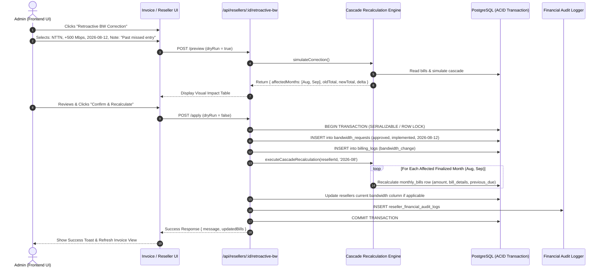

# Retroactive Bandwidth Correction & Multi-Month Cascade Recalculation System
## Architecture, Comprehensive Scenarios & 100% Implementation Blueprint

---

## ১. নির্বাহী সারসংক্ষেপ (Executive Summary)

### ১.১ সমস্যা ও প্রেক্ষাপট
আমাদের বিলিং সিস্টেমে রেগুলার ব্যান্ডউইথ পরিবর্তন সাধারণত চলতি মাসে অথবা নির্দিষ্ট প্রক্রিয়ার মাধ্যমে হয়। কিন্তু বাস্তব অপারেশনে প্রায়শই অনাকাঙ্ক্ষিত মানবিক ভুল বা নোটিফিকেশন বিলম্ব ঘটে। 
**উদাহরণস্বরূপ:**
* **রিসেলার ID:** `31`
* **বাস্তব ঘটনা:** ১২ আগস্ট থেকে ৫০০ এমবিপিএস NTTN ক্যাপাসিটি বৃদ্ধি পেয়েছিল।
* **মিসটেক:** পোর্টালের মাধ্যমে তখন এন্ট্রি বা আবেদন প্রসেস করা হয়নি।
* **বর্তমান সময়:** অক্টোবর মাস।
* **জটিলতা:** 
  1. ইতিমধ্যে আগস্ট (August) এবং সেপ্টেম্বর (September) মাসের বিল **Finalize** হয়ে গেছে।
  2. `monthly_bills` টেবিলে বিলের মোট অ্যামাউন্ট (`amount`) এবং আইটেম স্ন্যাপশট (`bill_details`) অপরিবর্তনীয় (immutable) হিসেবে স্টোর করা আছে।
  3. আগস্ট মাসের বিল পরিবর্তন হলে আগস্টের সমাপনী বকেয়া (Closing Balance) বৃদ্ধি পাবে।
  4. সেপ্টেম্বরের প্রারম্ভিক বকেয়া (`previous_due`) সরাসরি আগস্টের সমাপনী বকেয়ার ওপর নির্ভরশীল।
  5. অক্টোবরের রানিং ব্যালেন্স ও চলতি ইনভয়েস অ্যামাউন্টও চেইন আকারে বদলে যাবে।
  6. বর্তমানে এই ধরনের সংশোধনের জন্য সফটওয়্যার ইঞ্জিনিয়ার বা আইটি পার্সনকে ব্যাকএন্ড/ডাটাবেজে ঢুকে জটিল স্ক্রিপ্ট বা ম্যানুয়াল এসকিউএল চালাতে হয়—যা অত্যন্ত ঝুঁকিপূর্ণ, সময়সাপেক্ষ এবং সাধারণ অ্যাডমিনদের জন্য অসম্ভব।

### ১.২ সমাধান লক্ষ্যমাত্রা (Goal)
অ্যাডমিনদের জন্য ইনভয়েস পেজ (`/invoice?resellerId=31`) এবং সংশ্লিষ্ট রিসেলার প্রোফাইল পেজে এমন একটি সেলফ-সার্ভিস, ফুল-প্রুফ **"Retroactive Bandwidth Correction & Recalculate"** সিস্টেম তৈরি করা, যার মাধ্যমে:
- অ্যাডমিন কোনো কোডিং বা ডাটাবেজ এক্সেস ছাড়াই ফ্রন্টএন্ড UI থেকে যেকোনো পেছনের তারিখের ব্যান্ডউইথ সমন্বয় করতে পারবেন।
- সিস্টেম স্বয়ংক্রিয়ভাবে একটি ডাটাবেজ ট্রানজাকশনে সমস্ত সংশ্লিষ্ট মাসের বিল ও বকেয়া ক্যাসকেড (Cascade) আকারে নিখুঁতভাবে রি-ক্যালকুলেট করবে।
- প্রতিটি পরিবর্তনের জন্য বাধ্যতামূলক অ্যাডমিন নোট সহ সম্পূর্ণ অপরিবর্তনীয় অডিট ট্রেইল (`reseller_financial_audit_logs`) সংরক্ষিত থাকবে।
- সাবমিট করার আগেই অ্যাডমিন "Impact Preview" দেখতে পারবেন (কোন কোন মাসের বিল কত টাকা পরিবর্তিত হবে)।

---

## ২. সম্ভাব্য সমস্ত দৃশ্যপটের বিস্তারিত বিশ্লেষণ (Comprehensive Scenario Catalog)

অ্যাডমিনদের হাতে সিস্টেমটি তুলে দেওয়ার আগে সিস্টেমকে ফুল-প্রুফ করতে নিচের **৮টি প্রধান দৃশ্যপট** এবং এর প্রতিটি প্রান্তিক কেস (Edge Cases) চিহ্নিত করা হয়েছে:

```
+---------------------------------------------------------------------------------------------------+
|                                  SCENARIO TAXONOMY (14 SCENARIOS)                                 |
+---------------------------------------------------------------------------------------------------+
|  [Scenario 1] Past Finalized Month Upgrade/Downgrade (Core Case: Aug 12 NTTN +500 in Oct)         |
|  [Scenario 2] Current (Unfinalized) Month Back-dated Correction (e.g., Oct 2 entry done on Oct 7) |
|  [Scenario 3] Multiple Sequential Changes in Past Months (e.g., Aug 10 +200, Aug 20 +300)         |
|  [Scenario 4] Multi-Month Span / Cumulative Correction (Aug +500 applied, Sep had another change) |
|  [Scenario 5] Reseller Had Mid-Period Payments & Discounts (Financial ledger preservation)        |
|  [Scenario 6] Rate-Change Intersecting with Back-dated Bandwidth Change                           |
|  [Scenario 7] Downgrade / Negative Net Adjustment (Previous Due decreases / Credit balance)       |
|  [Scenario 8] Partial Days / Mid-Month Joining Reseller (New reseller joined mid-month)          |
|  [Scenario 9] Inactive / Suspended Reseller Re-activation Back-dated Correction                   |
|  [Scenario 10] Custom Billing Cycle (From Day / To Day Partial Bill Previously Finalized)        |
|  [Scenario 11] Existing Manual Adjustment (monthly_bills.adjustment) Overwrite Protection        |
|  [Scenario 12] Channel Partner vs Regular Bandwidth Reseller Divergence Guard                     |
|  [Scenario 13] Real IP / OTC Add-on Retroactive Inclusion in Same Period                         |
|  [Scenario 14] Multiple Admins Concurrent Recalculation Race Condition Guard                     |
+---------------------------------------------------------------------------------------------------+
```

---

### সিনারিও ১: অতীতে চূড়ান্তকৃত মাসে ব্যান্ডউইথ বৃদ্ধি/হ্রাস (Past Finalized Month Upgrade/Downgrade)
* **বর্ণনা:** আগস্ট মাসের ১২ তারিখে NTTN ৫০০ এমবিপিএস বৃদ্ধি পাওয়ার কথা ছিল, কিন্তু তখন এন্ট্রি হয়নি। ইতিমধ্যে আগস্ট এবং সেপ্টেম্বরের বিল ফাইনাল করা হয়েছে।
* **জটিলতা:** 
  - আগস্টের বিল আইটেমে নতুন ২০ দিনের (১২ আগস্ট - ৩১ আগস্ট) NTTN চার্জ যুক্ত হতে হবে।
  - আগস্টের `monthly_bills.amount` বাড়বে।
  - সেপ্টেম্বরের `monthly_bills.previous_due` বৃদ্ধি পাবে।
  - সেপ্টেম্বরের বিলের মোট বকেয়া বাড়বে।
  - অক্টোবরের বর্তমান `fn_reseller_previous_due` স্বয়ংক্রিয়ভাবে সেপ্টেম্বরের নতুন সমাপনী জের দেখাবে।
* **সমাধান:** 
  - `bandwidth_requests` টেবিলে ব্যাক-ডেটেড `implementation_date` সহ রেকর্ড ইনসার্ট।
  - আগস্ট মাসের `calculateMonthlyBillBreakdown` পুনরায় চালানো।
  - আগস্টের `monthly_bills` রো আপডেট।
  - সেপ্টেম্বর মাসের `monthly_bills.previous_due` আপডেট।

---

### সিনারিও ২: চলতি মাসে (Unfinalized) পেছনের তারিখের সংশোধন (Current Month Back-dated)
* **বর্ণনা:** অক্টোবর মাসের ২ তারিখে ব্যান্ডউইথ বৃদ্ধি পেয়েছে, কিন্তু অ্যাডমিন অক্টোবর মাসের ৭ তারিখে সিস্টেমে এন্ট্রি দিচ্ছেন।
* **বৈশিষ্ট্য:** অক্টোবর মাসের বিল এখনও ফাইনাল হয়নি (আন-ফাইনালইজড / প্রজেক্টেড বিল)।
* **সমাধান:** 
  - এটি তুলনামূলক সরল। `bandwidth_requests` টেবিলে কার্যকর তারিখ ২ অক্টোবর দিলে চলতি মাসের ক্যালকুলেটর ইঞ্জিন ডায়নামিকালি ২ তারিখ থেকে মাস শেষ পর্যন্ত প্রোরেটেড হিসাব করে নেয়।
  - কোনো পূর্ববর্তী `monthly_bills` রো আপডেট করার প্রয়োজন নেই, কেবল চলতি মাসের প্রজেকশন রিফ্রেশ হবে।

---

### সিনারিও ৩: অতীতের একই মাসে একাধিক তারিখের পরিবর্তন (Multiple Intra-Month Changes)
* **বর্ণনা:** আগস্ট মাসের ৫ তারিখে ১০০ এমবিপিএস বৃদ্ধি এবং পুনরায় ২০ তারিখে আরও ২০০ এমবিপিএস বৃদ্ধির ভুল একসাথে সংশোধন করা।
* **জটিলতা:** পুরো মাসকে ৩টি সেগমেন্টে ভাগ করতে হবে (১-৪ আগস্ট বেস, ৫-১৯ আগস্ট +১০০, ২০-৩১ আগস্ট +৩০০)।
* **সমাধান:** আমাদের ক্যালকুলেশন ইঞ্জিন (`service.js`-এর সেগমেন্টেশন লজিক) তারিখ অনুসারে ক্রমানুসারে সেগমেন্ট ভাগ করে প্রোরেটেড ডে-কাউন্ট হিসাব করতে সক্ষম। ক্যাসকেড সার্ভিস প্রতিটি তারিখের ইমপ্যাক্ট একসাথে সমন্বয় করবে।

---

### সিনারিও ৪: একাধিক অতীত মাসের ওপর ধারাবাহিকভাবে প্রভাব (Multi-Month Cumulative Span)
* **বর্ণনা:** আগস্ট ১২ তারিখে বৃদ্ধি পাওয়া ৫০০ এমবিপিএস সেপ্টেম্বর মাসেও পুরো ৩০ দিন কার্যকর ছিল (কারণ সেপ্টেম্বরে এটি কমানো হয়নি)।
* **ভুল এড়ানোর নিয়ম:** অ্যাডমিন যদি আগস্ট ১২-তে ৫০০ এমবিপিএস বৃদ্ধির এন্ট্রি দেন, তবে সেপ্টেম্বরের প্রারম্ভিক ক্যাপাসিটিও কিন্তু ওই ৫০০ বেশি থাকা উচিত ছিল! যদি সেপ্টেম্বরের বিল ক্যালকুলেশনের সময় সেপ্টেম্বরের বেইজ ব্যান্ডউইথে এই ৫০০ যুক্ত না থাকে, তবে সেপ্টেম্বরের নিজস্ব বিলের পরিমাণও কমে থাকবে।
* **সমাধান:** 
  - সিস্টেমে আগস্ট ১২-এর কারেকশন এন্ট্রি দিলে তা আগস্ট মাসের ক্যালকুলেশনে যেমন প্রভাব ফেলবে, ঠিক তেমনি সেপ্টেম্বরের পুরো মাসের বেইজ ক্যাপাসিটিতেও ৫০০ এমবিপিএস গণ্য করে সেপ্টেম্বরের `monthly_bills.amount`-ও রি-ক্যালকুলেট করতে হবে।
  - আগস্ট ও সেপ্টেম্বর উভয় মাসের বিল রিক্যালকুলেট হয়ে অক্টোবরের প্রারম্ভিক বকেয়ায় গিয়ে দাঁড়াবে।

---

### সিনারিও ৫: রিসেলারের মধ্যবর্তী পেমেন্ট ও ডিসকাউন্ট বিদ্যমান থাকা (Intervening Ledger Activity)
* **বর্ণনা:** আগস্ট বা সেপ্টেম্বরে রিসেলার আংশিক বা পূর্ণ পেমেন্ট করেছে, অথবা কিছু ডিসকাউন্ট পেয়েছে যা `billing_logs` টেবিলে লিপিবদ্ধ আছে।
* **নিয়ম:** কোনো অবস্থাতেই রিসেলারের পেমেন্ট রেকর্ড বা ডিসকাউন্ট লগ মোছা বা পরিবর্তন করা যাবে না।
* **ক্যালকুলেশন নীতি:**
  $$\text{Closing Due} = \text{Previous Due} + \text{New Final Bill} + \text{Adjustment} + \text{Product Charges} - \text{Payments} - \text{Discounts}$$
  পেমেন্ট ও ডিসকাউন্ট অপরিবর্তিত থাকবে; কেবল বিলের পরিমাণ বৃদ্ধি পাওয়ায় অবশিষ্ট বকেয়া (Remaining Due) সেই অনুপাতে বাড়বে।

---

### সিনারিও ৬: রেট চেঞ্জের সাথে ব্যান্ডউইথ পরিবর্তনের সংমিশ্রণ (Rate Change Intersection)
* **বর্ণনা:** ধরা যাক আগস্টের ১৫ তারিখে NTTN এর প্রতি এমবিপিএস রেট ১৫ টাকা থেকে কমে ১২ টাকা হয়েছিল (`reseller_rate_history` তে এন্ট্রি আছে)। আর আমাদের ব্যাক-ডেটেড ৫০০ এমবিপিএস কার্যকর হয়েছে ১২ আগস্ট।
* **সমাধান:**
  - ১২ আগস্ট থেকে ১৪ আগস্ট: ৫০০ এমবিপিএস @ ১৫ টাকা হারে।
  - ১৫ আগস্ট থেকে ৩১ আগস্ট: ৫০০ এমবিপিএস @ ১২ টাকা হারে।
  - আমাদের বিলিং ইঞ্জিনের `buildRateSegments` সাব-ফাংশন এই বহু-স্তরী সেগমেন্টেশন নিখুঁতভাবে হ্যান্ডেল করবে।

---

### সিনারিও ৭: ব্যান্ডউইথ হ্রাস বা নেগেটিভ সমন্বয় (Downgrade / Negative Delta Correction)
* **বর্ণনা:** রিসেলারের ব্যান্ডউইথ আগস্ট ১২ তারিখেই কমানো হয়েছিল, কিন্তু পোর্টালে এন্ট্রি না করায় অতিরিক্ত বিল এসেছে। এখন আগস্ট থেকে কমাতে হবে।
* **ফলাফল:** আগস্টের বিল কমবে, ফলে পরবর্তী মাসগুলোতে রিসেলারের বকেয়া হ্রাস পাবে বা ক্রেডিট ব্যালেন্স (অগ্রিম টাকা) তৈরি হতে পারে।
* **ব্যবস্থা:** সিস্টেম নেগেটিভ এবং পজিটিভ উভয় ডেল্টা নির্ভুলভাবে হ্যান্ডেল করবে।

---

### সিনারিও ৮: মাঝের কোনো তারিখে যোগদানকারী রিসেলার (Mid-Month Joined Reseller)
* **বর্ণনা:** কোনো রিসেলারের জয়েনিং ডেট ছিল ১০ আগস্ট। তার ব্যাক-ডেটেড কারেকশন ১২ আগস্টে দেওয়া হয়েছে।
* **ব্যবস্থা:** রিসেলারের জয়েনিং ডেটের আগের কোনো তারিখে কারেকশন ইনপুট গ্রহণযোগ্য হবে না (ভ্যালিডেশনে ব্লক করা হবে)।

---

### সিনারিও ৯: নিষ্ক্রিয় বা সাময়িক বন্ধ (Suspended/Inactive) রিসেলারের ব্যাক-ডেট সংশোধন
* **বর্ণনা:** রিসেলার হয়তো সেপ্টেম্বরের ২০ তারিখ থেকে সাসপেন্ডেড/ইনঅ্যাক্টিভ ছিল। কিন্তু আগস্ট বা সেপ্টেম্বরের শুরুতে ব্যান্ডউইথ পরিবর্তনের বিল ভুল ছিল।
* **ঝুঁকি:** সাধারণ নিয়মে ইনঅ্যাক্টিভ রিসেলারের বিলিং প্রজেকশন পজ থাকে (`shouldPauseProjectedBilling`)। কিন্তু ফাইনাল বিল রিক্যালকুলেশনের ক্ষেত্রে অতীতে অ্যাক্টিভ থাকা সময়কালের বিল অবশ্যই আপডেট হতে হবে।
* **সমাধান:** রিক্যালকুলেশন ইঞ্জিন চেক করবে ওই মাসে রিসেলার অ্যাক্টিভ ছিল কিনা বা ওই মাসের ফাইনাল বিল রো বিদ্যমান আছে কিনা। অতীতে ফাইনাল হওয়া বিল রিসেলারের বর্তমান স্ট্যাটাস নির্বিশেষে সঠিক হিসাবে রিক্যালকুলেট হবে।

---

### সিনারিও ১০: কাস্টম বিলিং পিরিয়ড (From Day / To Day) সমন্বয়
* **বর্ণনা:** কিছু রিসেলারের বিল পুরো মাসের (১-৩১) না হয়ে আংশিক সময়ের (যেমন ১২ থেকে ২৫ তারিখ) জন্য ফাইনাল করা হয়েছিল।
* **জটিলতা:** রিক্যালকুলেশন করার সময় যদি আমরা বাই-ডিফল্ট পুরো ৩১ দিনের হিসাব চালাই, তবে পূর্বের স্পেশাল পিরিয়ড ওভাররাইট হয়ে ভুল বিল তৈরি হবে।
* **সমাধান:** পূর্বের `monthly_bills.bill_details` থেকে অরিজিনাল বিলিং পিরিয়ডের ডে-রেঞ্জ (`from_day`, `to_day`) রিড করা হবে এবং ঠিক সেই রেঞ্জ মেইনটেইন করেই রিক্যালকুলেশন রান করা হবে।

---

### সিনারিও ১১: পূর্বে বিদ্যমান ম্যানুয়াল অ্যাডজাস্টমেন্ট (`monthly_bills.adjustment`) সংরক্ষণ
* **বর্ণনা:** আগস্ট মাসে হয়তো কোনো স্পেশাল কারণে অ্যাডমিন আগে থেকেই ৳ ৫,০০০ ডিসকাউন্ট/অ্যাডজাস্টমেন্ট এন্ট্রি দিয়ে বিল ফাইনাল করেছিলেন (`monthly_bills.adjustment = -5000`, `adjustment_note = 'Flood relief concession'`)।
* **ঝুঁকি:** ব্যান্ডউইথ রিক্যালকুলেশনে যদি `amount` পুনরায় হিসাব করার সময় `adjustment` ফিল্ড মুছে যায় বা রিসেট হয়, তবে ফিন্যান্সিয়াল ডিজাস্টার ঘটবে।
* **সমাধান:** ক্যাসকেড ইঞ্জিন পূর্বের `adjustment` এবং `adjustment_note` অক্ষুণ্ন রাখবে; কেবল বেস `amount` এবং `bill_details` আপডেট করবে এবং লেজার ক্যাসকেডে সেই অ্যাডজাস্টমেন্ট সহ ক্লোজিং ব্যালেন্স বের করবে।

---

### সিনারিও ১২: চ্যানেল পার্টনার বনাম রেগুলার ব্যান্ডউইথ রিসেলার পার্থক্য গার্ড
* **বর্ণনা:** রিসেলারের `partner_type` যদি `channel_partner` হয়, তাদের বিল কিন্তু ব্যান্ডউইথের ওপর হয় না—তাদের বিল হয় সাবস্ক্রাইবার কালেকশন এবং কমিশন শেয়ারের ওপর।
* **ব্যবস্থা:** সিস্টেমে গার্ড থাকবে যাতে অ্যাডমিন চ্যানেল পার্টনারের জন্য ভুলবশত ব্যান্ডউইথ কারেকশন সাবমিট করতে না পারেন (UI তেই অপশন হাইড থাকবে এবং ব্যাকএন্ডে ভ্যালিডেশন চেক থাকবে: `partner_type !== 'channel_partner'`)।

---

### সিনারিও ১৩: একই সাথে রিয়েল আইপি (Real IP) বা ওটিসি (OTC) পরিবর্তনের প্রভাব
* **বর্ণনা:** অতীতে ব্যান্ডউইথ বৃদ্ধির পাশাপাশি হয়তো ২টা রিয়েল আইপিও যুক্ত হয়েছিল যা বিল ফাইনাল করার সময় হিসাবে আসেনি।
* **সমাধান:** ব্যান্ডউইথ কারেকশন ইঞ্জিনের এক্সটেন্ডেবল ডিজাইনে এমন প্রভিশন রাখা হয়েছে যাতে অ্যাডমিন ভবিষ্যতে চাইলে কেবল ব্যান্ডউইথ নয়, রিয়েল আইপি কাউন্টও ব্যাক-ডেটেড কারেকশন মোডাল থেকে সমন্বয় করতে পারেন।

---

### সিনারিও ১৪: একাধিক অ্যাডমিনের সমান্তরাল রিক্যালকুলেশন ও রেস কন্ডিশন (Race Condition Guard)
* **বর্ণনা:** একই সাথে দুজন অ্যাডমিন একই রিসেলারের ইনভয়েসে কাজ করছেন এবং দুজনই ভিন্ন বা একই কারেকশন সাবমিট করলেন।
* **ঝুঁকি:** কনকারেন্ট রিকোয়েস্টে ডাটাবেজের `monthly_bills` টেবিলে অমিল বা ডুপ্লিকেট ক্যাসকেড ক্যালকুলেশন হতে পারে।
* **সমাধান:** ডাটাবেজ ট্রানজাকশনের শুরুতেই `SELECT id FROM resellers WHERE id = $1 FOR UPDATE` রো-লেভেল এক্সক্লুসিভ লক নেওয়া হবে। প্রথম অ্যাডমিনের ট্রানজাকশন পুরোপুরি কমিট হওয়ার আগে দ্বিতীয় রিকোয়েস্ট আটকে থাকবে এবং পরবর্তী রিকোয়েস্ট লেটেস্ট ডাটা রিড করবে।


---

## ৩. প্রযুক্তিগত স্থাপত্য ও ডাটাবেজ ক্যাসকেড অ্যালগরিদম (Technical Architecture & Cascade Logic)

### ৩.১ লেজার ক্যাসকেড গাণিতিক মডেল (Mathematical Ledger Propagation)

ধরা যাক সংশোধন শুরু হয়েছে মাস $M_0$ (যেমন `2026-08`) থেকে।
বর্তমান মাস $M_{now}$ (যেমন `2026-10`)।
প্রভাবিত মাসগুলোর সেট: $\{M_0, M_1, \dots, M_{now-1}\}$ যা ইতিমধ্যেই `monthly_bills` টেবিলে বিদ্যমান।

প্রতিটি মাসের জন্য ক্যাসকেড লুপ:
1. **$M_i$ মাসের জন্য:**
   - নতুন বা সংশোধিত ব্যান্ডউইথ/রেট ডেটা লোড করা হবে।
   - $M_i$ মাসের জন্য `calculateMonthlyBillBreakdown(resellerId, monthYm, resellerData)` কল করে নতুন `NewAmount` এবং নতুন `NewBillDetails` তৈরি করা হবে।
   - যদি $i = 0$ হয় (প্রথম মাস $M_0$), তবে তার $PreviousDue$ অপরিবর্তিত থাকবে।
   - যদি $i > 0$ হয়, তবে:
     $$PreviousDue_{M_i} = PreviousDue_{M_{i-1}} + NewAmount_{M_{i-1}} + Adjustment_{M_{i-1}} + Products_{M_{i-1}} - Payments_{M_{i-1}} - Discounts_{M_{i-1}}$$
   - $M_i$ মাসের `monthly_bills` রো আপডেট করা হবে:
     ```sql
     UPDATE monthly_bills
     SET amount = $1,
         bill_details = $2,
         previous_due = $3
     WHERE id = $4;
     ```

2. **লুপ শেষে:**
   - `resellers` টেবিলের বর্তমান ক্যাপাসিটি কলাম (`nttn_capacity`, `iig_bw` ইত্যাদি) সর্বশেষ বাস্তব মানের সাথে সমন্বয় করা হবে।
   - `reseller_financial_audit_logs` টেবিলে পুরো অপারেশনের একটি কম্প্রিহেনসিভ অডিট রেকর্ড ইনসার্ট করা হবে।

---

### ৩.২ সিস্টেম আর্কিটেকচার ডায়াগ্রাম



---

## ৪. ফ্রন্টএন্ড UI/UX ডিজাইন স্পেসিফিকেশন (Frontend Experience)

### ৪.১ বাটন প্লেসমেন্ট (Where will the Admin find it?)
* **লোকেশন ১:** [Invoice Page](file:///c:/Users/SN-IT/Documents/project/office/client/src/pages/Invoice.jsx) — টপ টুলবারে ("Finalized" ব্যাজের পাশে একটি নীল/অ্যাম্বার বাটন: `⚙️ Retroactive Correction`)।
* **লোকেশন ২:** Reseller Profile Page — "Bandwidth" ট্যাব বা "Billing" ট্যাবে একটি স্পেশাল অ্যাডমিন অ্যাকশন বাটন।

### ৪.২ ইন্টারঅ্যাকটিভ মোডাল ইন্টারফেস (Correction Modal)
মোডালটিতে দুটি ধাপ থাকবে:

#### ধাপ ১: ইনপুট ফর্ম (Correction Input)
* **Reseller:** অটো-সিলেক্টেড (উদা: Reseller 31 - Sync Online)
* **Bandwidth Type (ড্রপডাউন):** NTTN / IIG / BDIX / CDN / BCDN / GGC / FNA
* **Change Action (রেডিও/সুইচ):** 
  - `(+) Increase` (প্যাকেজ বৃদ্ধি)
  - `(-) Decrease` (প্যাকেজ হ্রাস)
* **Correction Amount (ইনপুট):** `500` Mbps
* **Effective Date (ডেটপিকার):** `2026-08-12` (ক্যালেন্ডার থেকে পেছনের তারিখ বেছে নেওয়া যাবে)
* **Admin Reason / Justification (বাধ্যতামূলক টেক্সটবক্স):** 
  * "আগস্ট ১২ থেকে ৫০০ এমবিপিএস বৃদ্ধি কার্যকর ছিল কিন্তু সিস্টেমে এন্ট্রি মিস হয়েছিল।" *(নোট ছাড়া সাবমিট বাটন ডিসেবল থাকবে)*
* **"Preview Impact" বাটন**

#### ধাপ ২: প্রভাব পর্যবেক্ষণ ও নিশ্চিতকরণ (Impact Preview Grid)
অ্যাডমিন "Preview Impact" এ ক্লিক করলে ব্যাকএন্ড সিমুলেশন রান করে একটি তুলনামূলক ছক দেখাবে:

| মাস (Month) | বিল স্ট্যাটাস | পূর্বের বিল (Old Bill) | নতুন বিল (New Bill) | পূর্বের বকেয়া (Prev Due) | নতুন সমাপনী বকেয়া (New Closing) | পরিবর্তন ($\Delta$) |
|:---:|:---:|:---:|:---:|:---:|:---:|:---:|
| **August 2026** | Finalized | ৳ ৩৫,০০০.০০ | ৳ ৪১,৪৫১.৬০ | ৳ ০.০০ | ৳ ৪১,৪৫১.৬০ | **+ ৳ ৬,৪৫১.৬০** |
| **September 2026** | Finalized | ৳ ৩৫,০০০.০০ | ৳ ৪৫,০০০.০০ | ৳ ৪১,৪৫১.৬০ | ৳ ৮৬,৪৫১.৬০ | **+ ৳ ১০,০০০.০০** |
| **October 2026** | Projected | ৳ ৩৫,০০০.০০ | ৳ ৪৫,০০০.০০ | ৳ ৮৬,৪৫১.৬০ | ৳ ১৩১,৪৫১.৬০ | **+ ৳ ১০,০০০.০০** |

*সতর্কবার্তা:* *"এই পরিবর্তন কার্যকর করলে আগস্ট এবং সেপ্টেম্বর মাসের ফাইনাল বিল স্থায়ীভাবে নতুন হিসাবে আপডেট হবে এবং লেজার স্বয়ংক্রিয়ভাবে সমন্বয় হবে।"*
* **"Confirm & Recalculate" (সবুজ বাটন)** এবং **"Cancel"**

---

## ৫. ব্যাকএন্ড এপিআই ও সিকিউরিটি স্পেসিফিকেশন (API & Security Contracts)

### ৫.১ এপিআই এন্ডপয়েন্ট ডিজাইন

#### ১. প্রিভিউ সিমুলেশন এন্ডপয়েন্ট:
* **Route:** `POST /api/resellers/:resellerId/retroactive-bandwidth/preview`
* **Permission:** `billing.invoice.view` অথবা `billing.generate_bill`
* **Request Body:**
  ```json
  {
    "bw_type": "NTTN",
    "change_type": "increase",
    "amount": 500,
    "effective_date": "2026-08-12",
    "admin_note": "Correction for missed NTTN upgrade"
  }
  ```
* **Response (200 OK):**
  ```json
  {
    "reseller_id": 31,
    "effective_date": "2026-08-12",
    "start_month": "2026-08",
    "affected_finalized_months": ["2026-08", "2026-09"],
    "preview_timeline": [
      {
        "month": "2026-08",
        "is_finalized": true,
        "old_amount": 35000.00,
        "new_amount": 41451.61,
        "old_previous_due": 0.00,
        "new_previous_due": 0.00,
        "delta": 6451.61
      },
      {
        "month": "2026-09",
        "is_finalized": true,
        "old_amount": 35000.00,
        "new_amount": 45000.00,
        "old_previous_due": 35000.00,
        "new_previous_due": 41451.61,
        "delta": 16451.61
      }
    ],
    "net_financial_impact": 16451.61
  }
  ```

#### ২. চূড়ান্ত এক্সিকিউশন এন্ডপয়েন্ট:
* **Route:** `POST /api/resellers/:resellerId/retroactive-bandwidth/apply`
* **Permission:** `billing.generate_bill` (Strict Super/Billing Admin permission)
* **Request Body:**
  ```json
  {
    "bw_type": "NTTN",
    "change_type": "increase",
    "amount": 500,
    "effective_date": "2026-08-12",
    "admin_note": "Approved by MD: missed August NTTN upgrade for Reseller 31"
  }
  ```
* **Response (200 OK):**
  ```json
  {
    "success": true,
    "message": "Retroactive bandwidth correction applied successfully and 2 finalized bills recalculated.",
    "affected_months": ["2026-08", "2026-09"],
    "audit_log_id": 1842
  }
  ```

### ৫.২ ডাটাবেজ ইন্টিগ্রিটি ও ট্রানজাকশন সেফগার্ডস (Safety Guarantees)
1. **Row-Level Lock:** ট্রানজাকশনের শুরুতে `SELECT * FROM resellers WHERE id = $1 FOR UPDATE` চালানো হবে যাতে সমান্তরাল অন্য কোনো ফাইনাল বা পেমেন্ট রিকোয়েস্ট একই সময়ে ঢুকে অসংগতি না তৈরি করতে পারে।
2. **Atomic Rollback:** আগস্ট বা সেপ্টেম্বর কোনো একটি মাসের বিল আপডেটে ১ পয়সাও অমিল বা এরর হলে পুরো ট্রানজাকশন মুহূর্তেই `ROLLBACK` হবে; ডাটাবেজে আংশিক পরিবর্তন থাকবে না।
3. **Audit Log Mandatory Requirement:** অ্যাডমিন নোট ছাড়া রিকোয়েস্ট রিজেক্ট হবে (HTTP 400)। অ্যাক্টরের আইপি, ইউজার আইডি, পরিবর্তনের পূর্বের ও পরের জের `reseller_financial_audit_logs` টেবিলে লিখিত হবে।

---

## ৬. মাল্টি-এজেন্ট টিমওয়ার্ক রোলস (Multi-Agent Implementation Team Roles)

বাস্তবায়নের সময় কাজটিকে আমরা ৩টি স্পষ্ট এজেন্টে ভাগ করব:

| Agent | বিশেষত্ব ও দায়িত্ব (Role & Responsibilities) | প্রধান ফাইলসমূহ (Target Files) |
|---|---|---|
| **Agent 1: Financial Core Engine** | - ক্যাসকেড রিক্যালকুলেশন সার্ভিস বাস্তবায়ন<br>- প্রোরেটেড ডে-কাউন্ট এবং স্ন্যাপশট জেনারেশন<br>- লেজার প্রোপাগেশন অ্যালগরিদম টেস্টিং | `server/controllers/reseller/service.js`<br>`server/controllers/reseller/billing.js`<br>`server/controllers/reseller/retroactiveCorrection.js` |
| **Agent 2: Controller & Security API** | - প্রিভিউ ও অ্যাপ্লাই এন্ডপয়েন্ট বাস্তবায়ন<br>- অডিট লগ ও ট্রানজাকশন র‍্যাপার<br>- ভ্যালিডেশন গার্ড ও পারমিশন ইন্টিগ্রেশন | `server/routes/resellerRoutes.js`<br>`server/controllers/reseller/retroactiveController.js`<br>`server/tests/financial-retroactive.test.cjs` |
| **Agent 3: UI/UX & Invoice Frontend** | - ইনভয়েস ও প্রোফাইল পেজে "Retroactive Correction" মোডাল তৈরি<br>- ইমপ্যাক্ট প্রিভিউ টেবিল রেন্ডারিং<br>- লাইভ রিক্যালকুলেশন ও রিলোড ফ্লো | `client/src/pages/Invoice.jsx`<br>`client/src/components/Billing/RetroactiveCorrectionModal.jsx`<br>`client/src/services/resellerService.js` |

---

## ৭. চেকলিস্ট ও প্রস্তুতি (100% Ready-to-Execute Checklist)

- [x] সমস্ত সিনারিও চিহ্নিত (অতীতে বৃদ্ধি/হ্রাস, মাল্টি-মান্থ স্প্যান, রেট চেঞ্জ ইন্টারসেকশন, পেমেন্ট অক্ষুণ্ন রাখা)।
- [x] ডাটাবেজ ট্রানজাকশন ও ক্যাসকেড অ্যালগরিদমের গাণিতিক সমীকরণ প্রস্তুত।
- [x] ব্যাকএন্ড এপিআই কন্ট্রাক্ট (Request/Response payload) নির্ধারিত।
- [x] ফ্রন্টএন্ড মোডাল ও ইমপ্যাক্ট প্রিভিউ UI ডিজাইন নির্ধারিত।
- [x] পারমিশন ও অডিট লগিং ফ্রেমওয়ার্ক স্পেসিফায়েড।
- [x] মাল্টি-এজেন্ট টিমওয়ার্ক স্ট্রাকচার সংজ্ঞায়িত।

---
*ডকুমেন্টটি সম্পূর্ণ এবং বাস্তবায়নের জন্য প্রস্তুত। পরবর্তী নির্দেশে আমরা কোডিং ও টেস্ট বাস্তবায়ন শুরু করব।*
